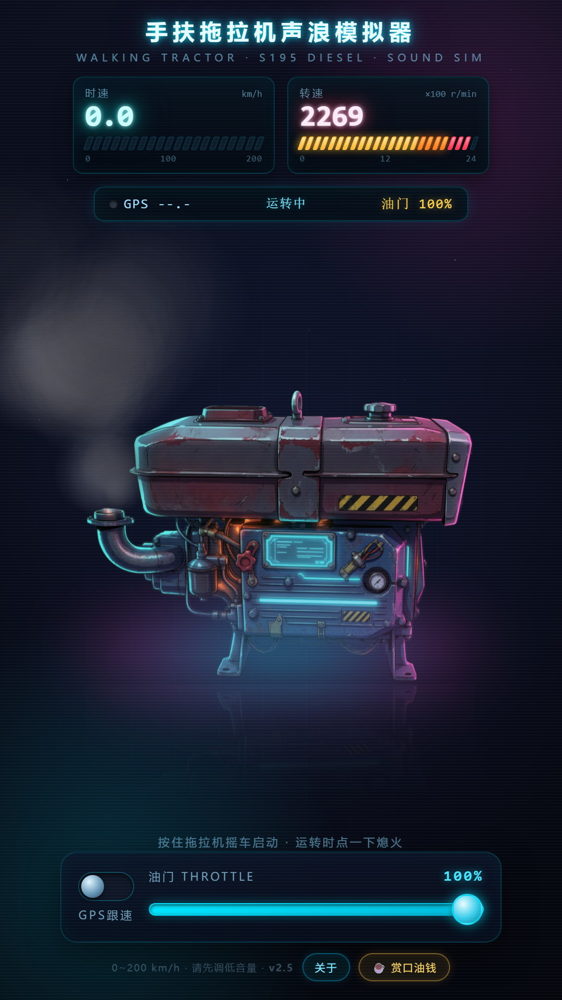
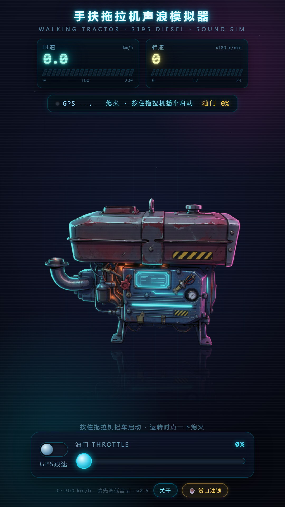
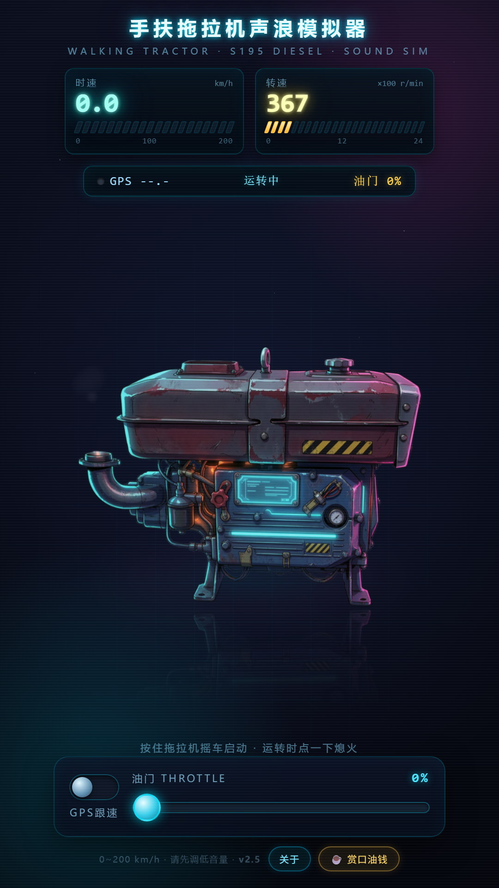

# 🚜 手扶拖拉机声浪模拟器

把一台 **S195 单缸柴油机**塞进浏览器：摇把启动、拉杆油门、排气浓烟、机械咔哒，一声不落。

纯前端单页 · 无需构建 · 完全离线 · 无账号 · 无广告 · 不采集任何个人信息 · 中 / 英 / 日 / 韩四语界面

**[▶ 在线试玩](https://dongchen.jin.github.io/tractor-sound/) ｜ [⬇ 下载 APK](https://github.com/dongchenjin/tractor-sound/releases/latest)**

> 上面两个链接里的 `<你的GitHub用户名>` 首次建仓后替换成你的用户名即可。



---

## 功能

- **真实采样基底**：6 段真实单缸柴油机点火循环（每段 202.5ms）+ 真实摇把启动录音，按转速变速播放，不是合成音贴上去的
- **摇把启动**：按住摇把转，转速爬升，10% 概率摇不着，得再来一次
- **非圆形仪表**：时速表 0~200 km/h（20 格 LED）、转速表 0~2400 rpm，140+ 转青、180+ 转红
- **全屏浓烟**：Canvas 粒子系统，负荷越大烟越浓越远，满油门几乎铺满屏幕；仪表区域羽化镂空，任何负荷下数字都看得清
- **两种驱动**：手动油门滑条，或 GPS 跟速（速度→转速映射，越快步越大声）
- **四语界面**：简体中文 / English / 日本語 / 한국어，右上角 🌐 一键切换并记忆，首次按系统语言自动匹配
- **熄火回位**：熄火瞬间「咔哒」一声，油门滑条自动弹回 0%
- **打赏彩蛋**：完全自愿，触发后有镀金车身 + 黄金烟

## 截图

| 待机 | 怠速运转 |
|---|---|
|  |  |

| GPS 跟速 68 km/h | 满油门浓烟 |
|---|---|
|  |  |

## 使用

### 在线玩

直接打开 <https://dongchenjin.github.io/tractor-sound/>

手机上建议「添加到主屏幕」，全屏无地址栏，跟 App 一模一样：

- **iOS Safari**：分享 → 添加到主屏幕
- **Android Chrome**：⋮ → 添加到主屏幕

> ⚠️ 请先调低音量再点启动。戴耳机大音量长时间使用可能损伤听力。

### 安装 APK（Android）

前往 [Releases](https://github.com/dongchen.jin/tractor-sound/releases/latest) 下载 `手扶拖拉机声浪.apk` 安装即可（约 940KB，Android 7.0+）。

首次安装需在系统里允许「安装未知来源应用」。网页版和 APK 是同一份代码，功能完全一致，APK 只是多了个桌面图标。

### 本地跑

```bash
git clone https://github.com/dongchenjin/tractor-sound.git
cd tractor-sound
python -m http.server 8000
# 打开 http://localhost:8000
```

> 直接双击 `index.html` 也能出声（`file://` 下资源按相对路径加载），但部分浏览器会限制本地音频，用本地服务器更稳。

### 操作

| 动作 | 效果 |
|---|---|
| 按住拖拉机本体 | 摇把启动，转速爬升 |
| 拖动油门滑条 | 调转速，0~100% |
| 打开 GPS 跟速 | 用真实速度驱动声浪 |
| 再点一次本体 | 熄火（附咔哒一声，油门自动回位） |

## 技术说明

- 单个 `index.html`，HTML/CSS/JS 全内联，零依赖、零构建
- 声学引擎：Web Audio API。每段点火采样按转速 `playbackRate` 播放，转速越高点火越密，重叠段做相位补偿与负荷增益；EQ（峰值/低通/高通）随负荷动态变化
- 烟雾：Canvas 2D 粒子，预渲染不规则烟团精灵（多圆随机叠加 3 变体），带旋转翻滚与湍流摆动；仪表区用 `destination-out` 径向渐变羽化镂空
- GPS：`navigator.geolocation.watchPosition`，速度仅在本机换算，不上传不存储

## 目录结构

```
.
├── index.html        # 全部代码（HTML+CSS+JS 单文件）
├── assets/           # 音效采样、拖拉机图、打赏收款码
├── screenshots/      # 商店/README 截图
├── privacy.html      # 隐私政策
└── icon.png          # 应用图标
```

## 隐私

不收集、不存储、不上传任何个人信息；无账号体系；无第三方 SDK；不联网（除本机资源加载）。

唯一敏感权限是定位，且只在主动开启「GPS 跟速」时调用，数据不出本机。应用内「关于 → 隐私政策」可展开完整政策全文，或见 [隐私政策](privacy.html)。

## 免责声明

本项目是**声音模拟娱乐程序**，非真实车辆产品，与任何车辆厂商、品牌、型号无关联，不具备任何驾驶辅助功能。

请在停车、居家等安全环境下使用；**严禁于驾驶、骑行、步行上路或操作机械时使用**。请先调低音量，注意听力保护。

音效采样来自公开素材库与自行录制处理，仅用于学习交流与娱乐。如涉版权问题请来信，将立即处理。

## 版权与素材

- **代码**：MIT License，见 [LICENSE](LICENSE)
- **音效 / 图片素材**：不适用 MIT，版权归原始来源；仅供本项目演示使用，请勿单独提取商用

## 联系

邮箱：**16386618@qq.com**（标题带上「拖拉机」回得更快）
